# Heart Disease Prediction: End-to-End MLOps
**Student:** SREEJA V J  
**Course:** MLOps (AIMLCZG523), Assignment 01  
**Repository:** https://github.com/sreejarepo/MLops 
**Date:** 18-10-2026  
**Demo video:** https://drive.google.com/file/d/19tLMqSR8QTFi2KamsZ3QJQGIrb-G8ACh/view?usp=sharing

## 1. Abstract and objectives
This project builds a binary classifier that predicts the presence of heart disease from the 13 clinical
features of the UCI Heart Disease dataset, and delivers it as a monitored, containerised API. The
objectives were to make every step reproducible and automated: data acquisition, cleaning, EDA,
training with experiment tracking (MLflow), tests and CI (GitHub Actions), packaging (Docker),
deployment on Kubernetes (Minikube) and monitoring with Prometheus and Grafana.

The deployed model is a tuned Random Forest with a 5-fold cross-validated ROC-AUC of 0.905. It is
served by a FastAPI service whose `/predict` endpoint returns the predicted class, a label and a
confidence value.

## 2. Dataset and acquisition
The data is the UCI Heart Disease dataset, **ID 45** (https://archive.ics.uci.edu/dataset/45/heart+disease),
downloaded programmatically by `download_data.py` through the `ucimlrepo` package, with no manual
download. The script retries three times and falls back to the committed CSV if the UCI server cannot be
reached. The result is **303 rows x 13 features** plus a target column. The original target (0 to 4) is
binarised: 0 means no disease and 1 to 4 means disease present, which gives **164 patients without
disease and 139 with disease**. The data comes from the UCI Machine Learning Repository, and the
original donors include the Cleveland Clinic Foundation.

## 3. Data quality and EDA
`src/clean.py` writes a cleaned copy to `data/processed/` and a `data_quality_report.json`. The
quality checks found:

- **Missing values:** only two columns, `ca` (4 rows) and `thal` (2 rows). They are imputed with the
  most frequent value (`ca` = 0, `thal` = 3), after which there are no missing values.
- **Duplicates:** none, so all 303 rows are kept.
- **Class balance:** 164 vs 139 (54.1% vs 45.9%), balanced enough that I do not resample.

The EDA notebook (`notebooks/01_eda.ipynb`) is executed and saved with its outputs. Its main findings:

- `thal` (r = 0.53), `ca` (0.46), `exang` (0.43), `oldpeak` (0.43) and `cp` (0.41) correlate most
  positively with disease. `thalach` (maximum heart rate) is the only strong negative correlation
  (r = -0.42): patients with disease average 139 bpm against 158 bpm without.
- Chest pain type 4 (asymptomatic) has the highest disease rate, 73% of 144 patients, so `cp` is
  treated as a category and not as an ordered scale.
- `oldpeak` (skew 1.27) and `chol` (skew 1.14, maximum 564) are right-skewed, which supports scaling the
  numeric features. The numeric features are only weakly correlated with each other (largest |r| = 0.39,
  `age` with `thalach`).
- `fbs` (r = 0.03) and `chol` (r = 0.09) are almost unrelated to the target on their own.
- The sample is 68% male (206 of 303), which limits how far the results generalise.

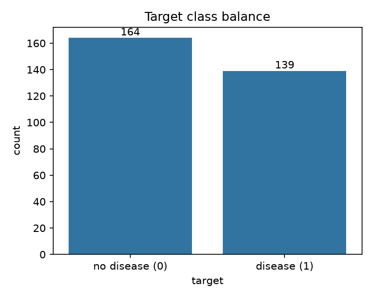
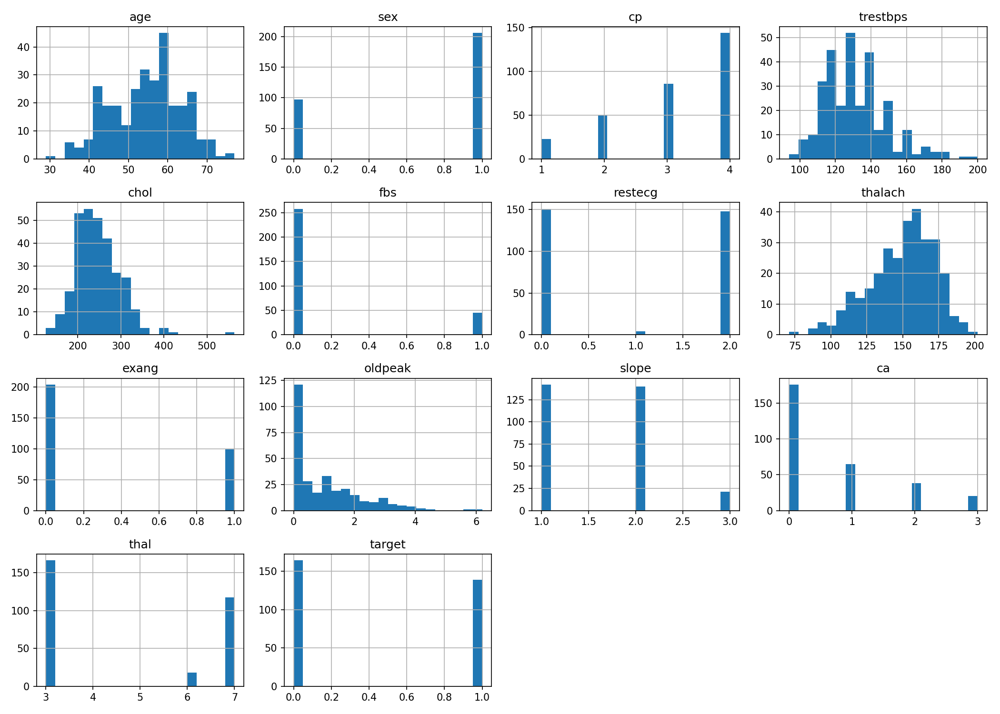
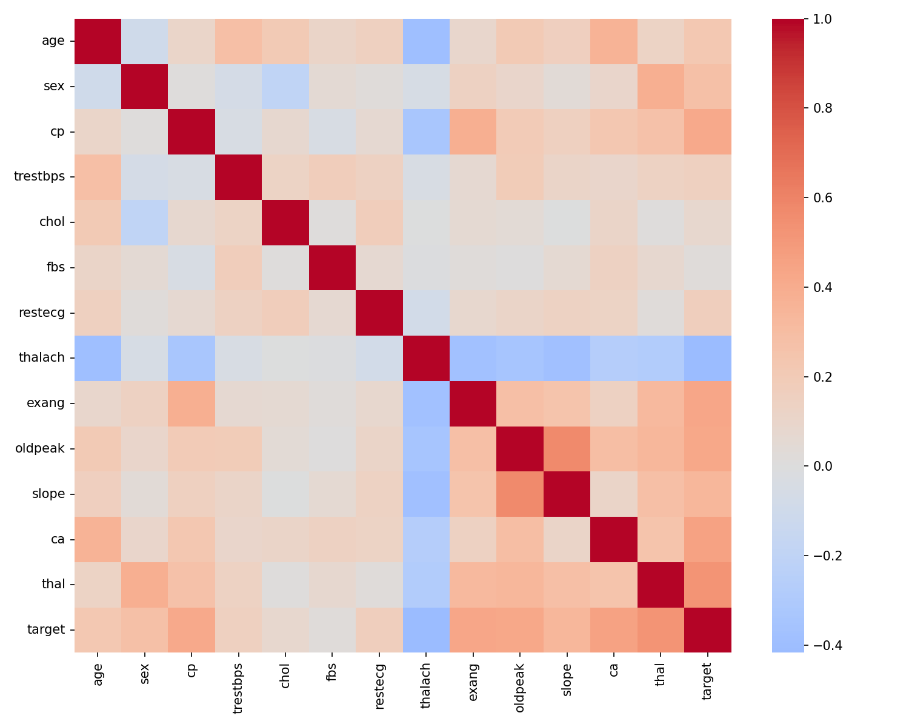
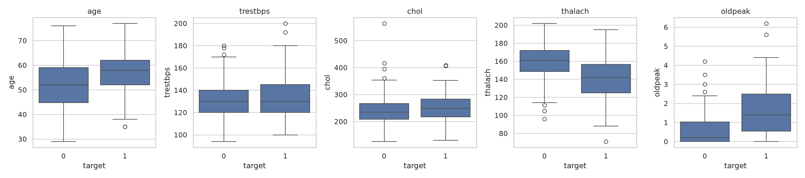

## 4. Preprocessing and feature engineering
All preprocessing lives **inside** the scikit-learn pipeline, so it is fitted on the training folds only
and cannot leak information from validation or test data.

- **Numeric features** (`age`, `trestbps`, `chol`, `thalach`, `oldpeak`): median imputation, then `StandardScaler`.
- **Categorical codes** (`sex`, `cp`, `fbs`, `restecg`, `exang`, `slope`, `ca`, `thal`): most-frequent
  imputation, then `OneHotEncoder(handle_unknown="ignore")`, so unseen categories at inference do not crash the API.
- **Split:** a stratified 80/20 train/test split with seed 42 (242 training and 61 test rows). The test set
  is never used to choose a model.

Training starts from the raw CSV, because the imputation happens in the pipeline. The cleaned copy from
`clean.py` is an inspectable artefact of the data-quality step.

## 5. Model development, tuning and evaluation
Two baselines were trained: **Logistic Regression** (`class_weight="balanced"`, `max_iter=2000`) and a
**Random Forest** (300 trees, `min_samples_leaf=2`, `class_weight="balanced"`). Each was evaluated with
stratified 5-fold cross-validation (accuracy, precision, recall, F1, ROC-AUC) and then once on the held-out
test set. The selection metric is the **mean cross-validated ROC-AUC**.

Tuning used `GridSearchCV` with the same 5-fold split and ROC-AUC scoring:

- Logistic Regression: `C` in {0.01, 0.1, 1, 10} and solver in {lbfgs, liblinear}, 8 combinations.
- Random Forest: `n_estimators` in {200, 400}, `max_depth` in {None, 6, 12}, `min_samples_leaf` in {1, 2, 4},
  `max_features` in {sqrt, log2}, 36 combinations.

A tuned model replaces the baseline only if its CV ROC-AUC is higher.

| Model | CV ROC-AUC | Test Acc | Test Precision | Test Recall | Test F1 | Test ROC-AUC |
|---|---|---|---|---|---|---|
| Logistic Regression (baseline) | 0.9025 | 0.869 | 0.813 | 0.929 | 0.867 | 0.966 |
| Random Forest (baseline) | 0.8955 | 0.902 | 0.844 | 0.964 | 0.900 | 0.950 |
| Tuned Logistic Regression (C = 0.1, liblinear) | 0.9031 | 0.885 | 0.839 | 0.929 | 0.881 | 0.966 |
| **Tuned Random Forest (deployed)** | **0.9052** | 0.869 | 0.813 | 0.929 | 0.867 | 0.952 |

The tuned Random Forest uses `n_estimators` = 400, `max_depth` = 6, `min_samples_leaf` = 2 and
`max_features` = log2.

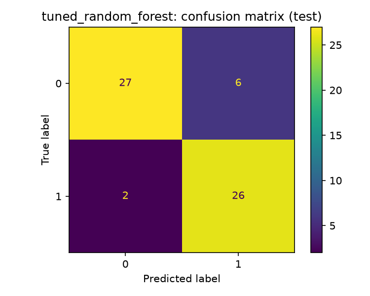
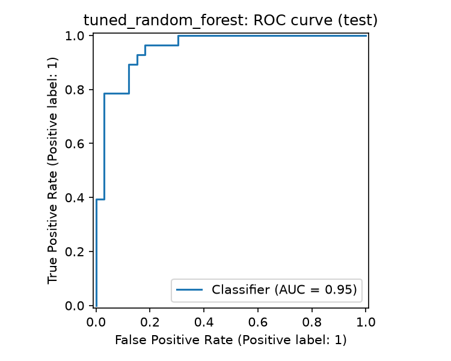

**Chosen model: the tuned Random Forest**, because it has the highest cross-validated ROC-AUC (0.9052) and
it beat the baseline CV score, which is the promotion rule I set before running the experiments. I note two
honest caveats. First, the gap to Logistic Regression is tiny (0.9052 against 0.9025 for the baseline and
0.9031 for the tuned version), so the two model families are effectively tied on this data. Second, the
test set has only 61 rows, so one patient changes accuracy by about 1.6 points; this is why the test
ranking differs from the CV ranking and why I did not select on the test set. Because the top candidates
are so close, I pinned the library versions so that the result is reproducible.

## 6. MLflow experiment tracking
`src/train.py` and `src/tune.py` log to the same MLflow backend (`sqlite:///mlflow.db`, with artifacts
under `mlruns/`), in two experiments: `heart-disease-classification` (the two baselines) and
`heart-disease-tuning` (the two tuned models). Every run logs:

- **Parameters:** model name, test size, random state, number of CV folds and the classifier hyperparameters.
- **Metrics:** five cross-validated scores and five held-out test scores.
- **Artifacts:** confusion matrix, ROC curve, classification report, the EDA plots, `requirements.txt`, the
  full grid-search results as CSV (tuning runs) and the fitted pipeline.

The best baseline run is tagged `selected_baseline`, and `reports/final_model.json` records which model is
deployed and where it came from.

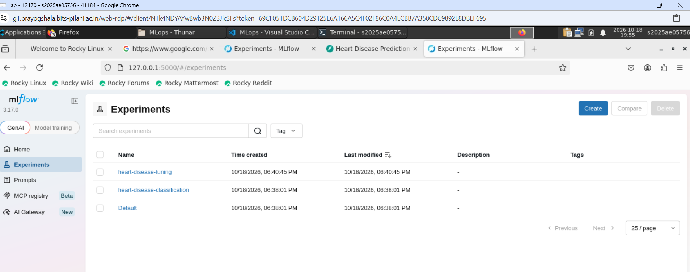
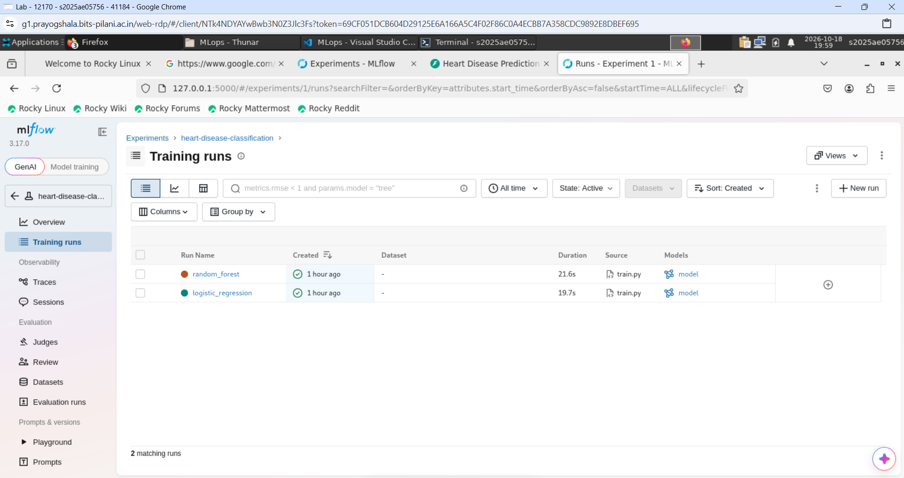
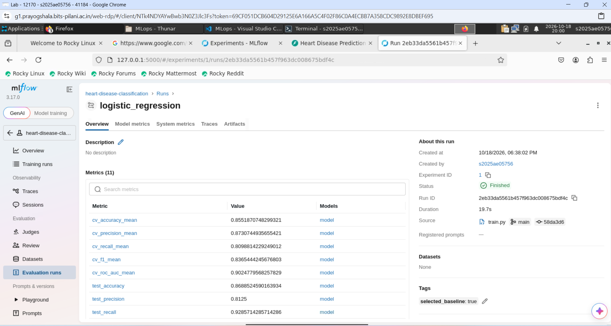
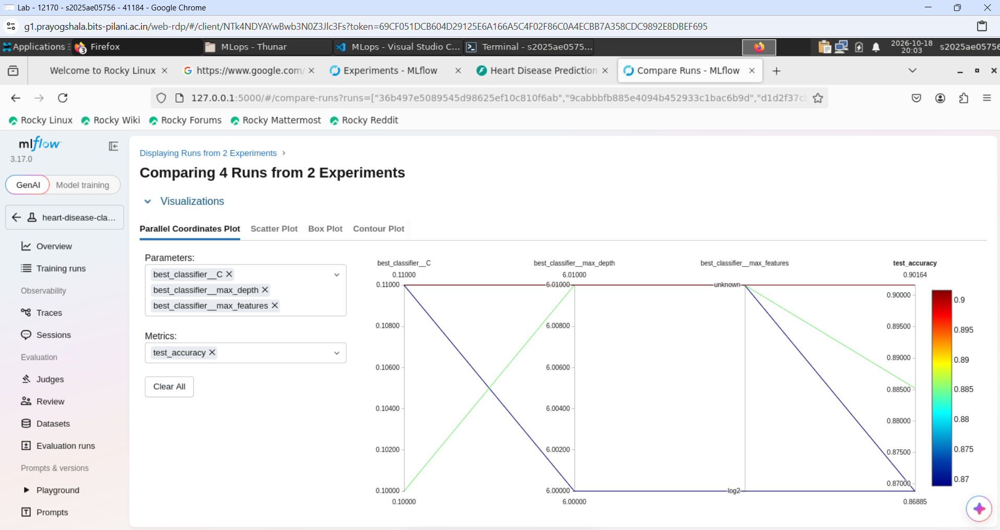
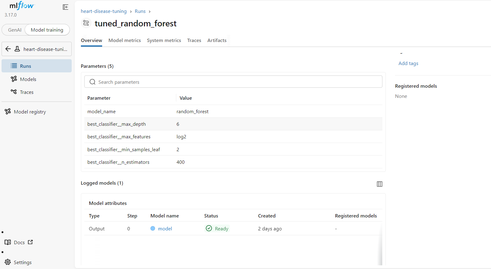

## 7. Packaging and reproducibility
The final pipeline, including the preprocessing, is saved with joblib as `models/heart_disease_model.joblib`
and is the single artefact used by the API, the Docker image and the Kubernetes deployment. A single
`requirements.txt` serves the API, training, tests, notebook execution, CI and Docker. The core scientific
libraries are pinned (numpy 2.4.2, pandas 2.3.3, scikit-learn 1.8.0, scipy 1.17.1, mlflow 3.17.0) and all
random seeds are fixed. To reproduce from scratch:

```
pip install -r requirements.txt
python download_data.py && python -m src.clean
python -m src.train && python -m src.tune
```

Batch inference is also available from the command line: `python -m src.inference --sample` or
`--input patients.csv --output predictions.csv`.

## 8. Automated tests and CI/CD
The test suite has **34 tests in 7 files**: data loading and validation (6), cleaning (3), model and
preprocessing contracts (4), training and MLflow logging (5), tuning and the promotion rule (5), batch
inference (4) and the API endpoints and schemas (7). The tests use small synthetic datasets and an isolated
MLflow store, so they do not touch the real runs. `ruff` is used for linting and passes cleanly.

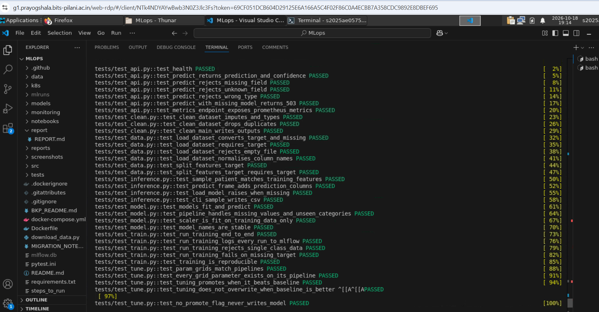
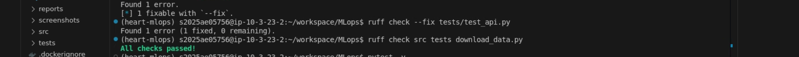

The GitHub Actions workflow `ci.yml` runs on every push and pull request with four jobs:

1. **lint:** `ruff check`.
2. **test:** `pytest`, with the JUnit report uploaded as an artifact.
3. **train** (after lint and test): download the dataset, build the cleaned dataset, execute the EDA
   notebook, train with MLflow logging, publish a metrics table to the job summary and upload the artifacts.
4. **docker** (after lint and test): build the image, start the container and call `/health`, `/predict`
   (the response must contain `confidence`) and `/metrics/`, then print the container logs.

A failing step fails the workflow. A second workflow, `tune.yml`, runs the hyperparameter search on demand.
To confirm that the pipeline really blocks bad changes, I also pushed a deliberate lint error on a scratch
branch and saved the failed run.

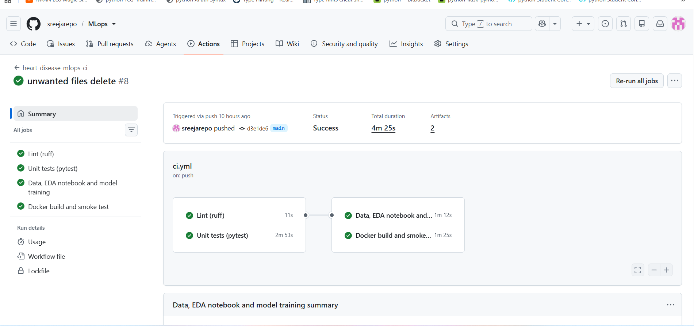
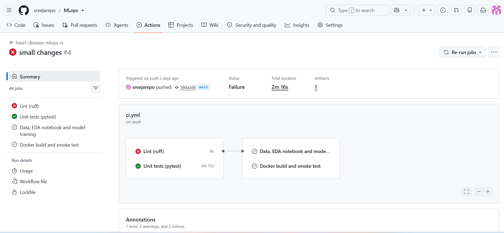

## 9. API, containerisation and Kubernetes deployment
**API.** The FastAPI service (`src/api.py`) exposes `POST /predict`, `GET /health` (used by the Kubernetes
probes), `GET /metrics/` (Prometheus) and the interactive `/docs`. The request body is validated against a
Pydantic schema that rejects unknown fields and wrong types with HTTP 422. A response contains
`prediction`, `label`, `confidence` (the probability of the predicted class), the class probabilities, the
model version and a notice that it is not a medical diagnosis. Each request and each prediction is also
written as a JSON log line.

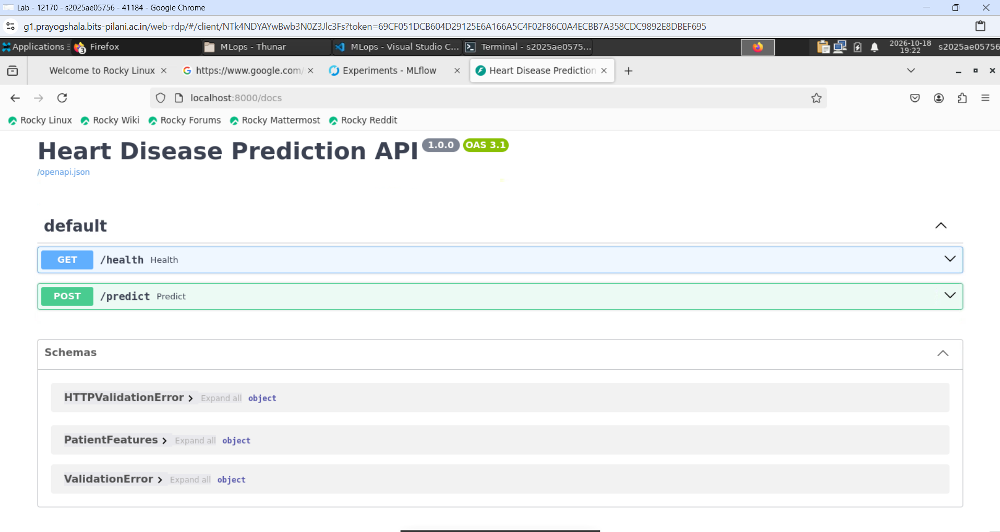
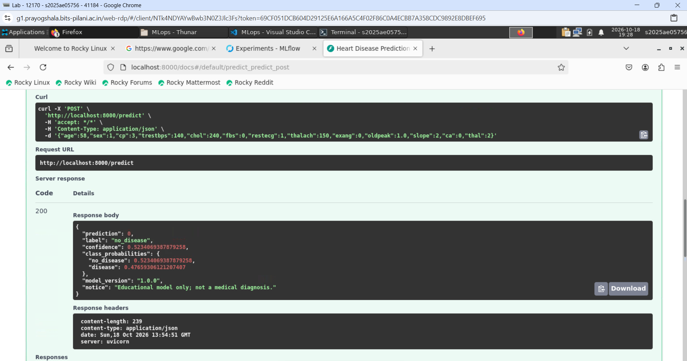

**Docker.** The image `heart-disease-api:1.0.0` is built from `python:3.11-slim`, installs
`requirements.txt`, copies the source and the model, defines a `HEALTHCHECK` on `/health` and starts
`uvicorn` on port 8000.

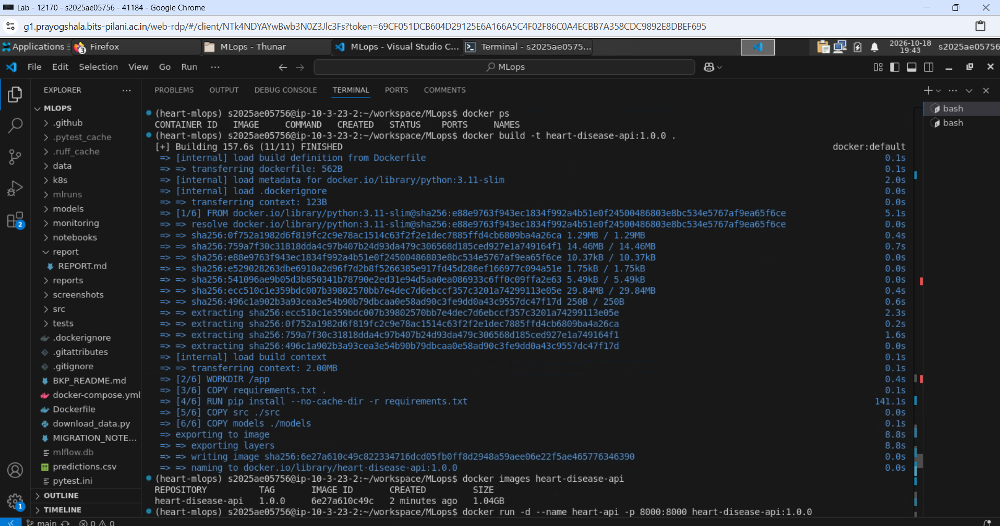
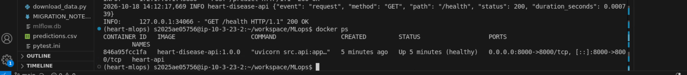
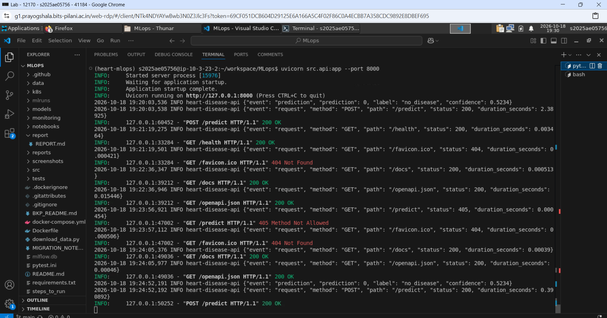

**Kubernetes (Minikube).** `k8s/deployment.yaml` defines a Deployment with **2 replicas** running the
image, with readiness and liveness probes on `/health`, resource requests (100m CPU, 256Mi memory) and
limits (500m CPU, 768Mi memory), and a Service of type **LoadBalancer** that maps port 80 to container
port 8000. I started the cluster with `minikube start --driver=docker`, loaded the locally built image
into it with `minikube image load` (the image is not in a registry, so the manifest uses
`imagePullPolicy: IfNotPresent`), and applied the manifest. Both pods reached `Running 1/1`. Because a
local cluster has no cloud load balancer, I reached the service with `kubectl port-forward` (an alternative
is `minikube tunnel`) and called `/health` and `/predict` through it. The container logs show the same
JSON log lines as the local run.

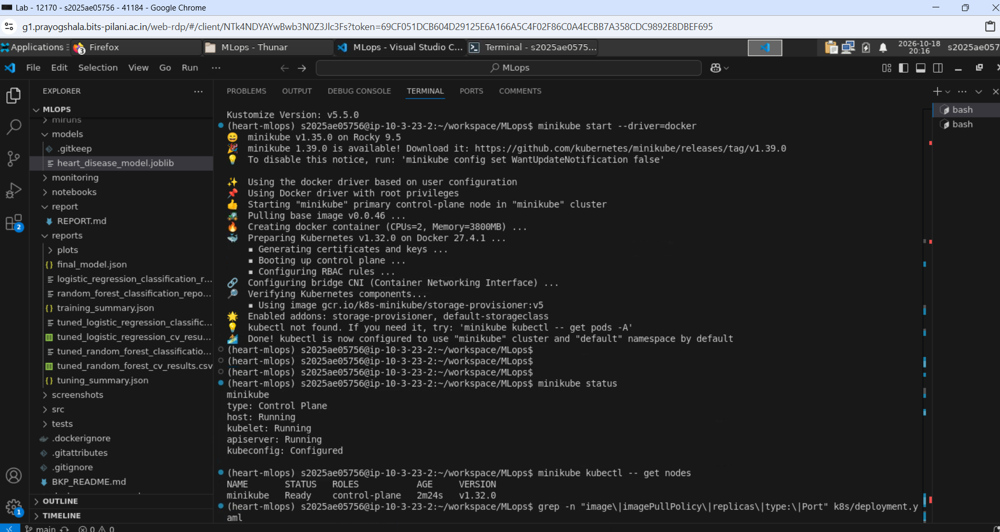
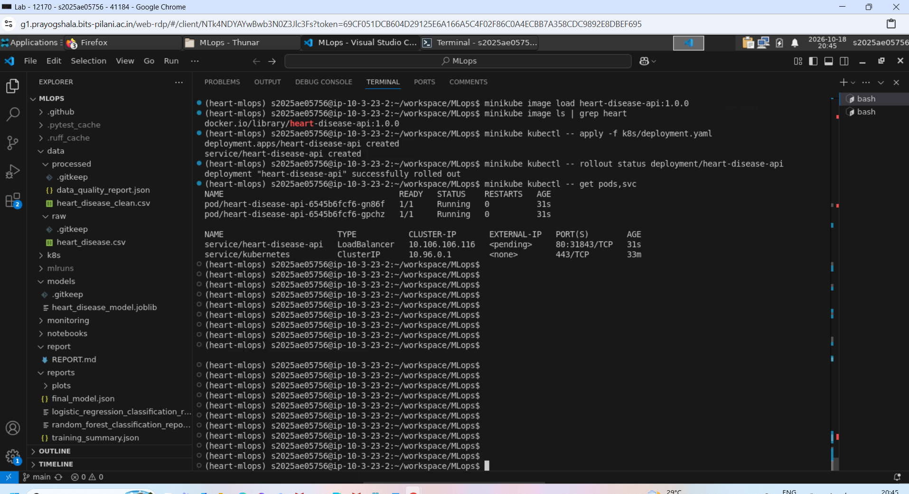
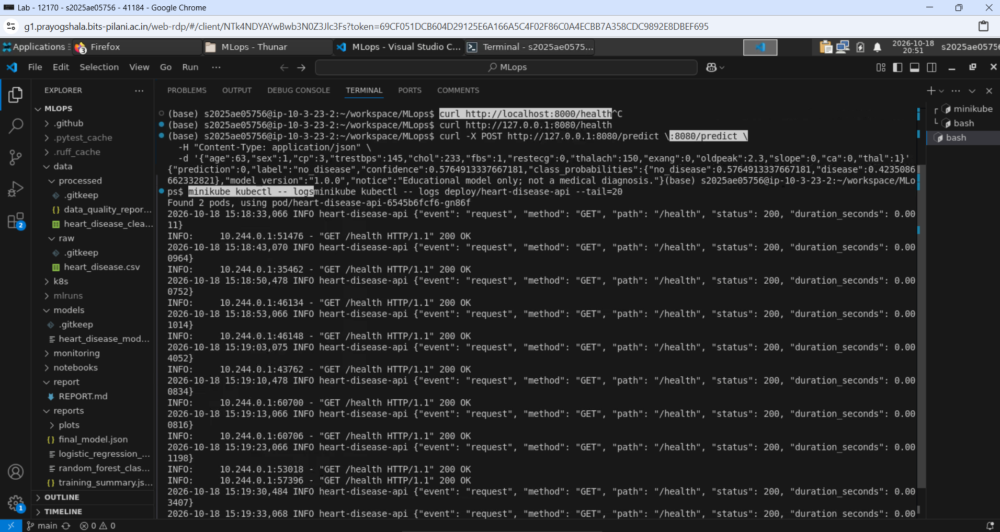

**Access instructions (local deployment):**

```
minikube start --driver=docker
minikube image load heart-disease-api:1.0.0
minikube kubectl -- apply -f k8s/deployment.yaml
minikube kubectl -- port-forward svc/heart-disease-api 8080:80
curl http://127.0.0.1:8080/health
```

The cluster state at the time of the run is saved in `reports/k8s_state.txt`.

## 10. Monitoring, logging, limitations and conclusion
**Monitoring.** The API exposes three custom Prometheus metrics: `api_requests_total` (labelled by method,
endpoint and status), `api_request_duration_seconds` (a latency histogram per endpoint) and
`predictions_total` (labelled by predicted class). `docker compose up` starts the API on port 8002,
Prometheus on port 9090 (scraping `/metrics/` every 15 seconds) and Grafana on port 3000. The Grafana
datasource and an 8-panel dashboard are provisioned from files: total requests, total predictions, 5xx
error rate, API target up, request rate by endpoint, p95 latency by endpoint, predictions by class and
requests by status code. After I sent 60 test predictions, the dashboard showed 126 total requests
(the rest being health checks and metric scrapes), 60 predictions and the API target up. The 5xx panel is
empty because the service returned no server errors.

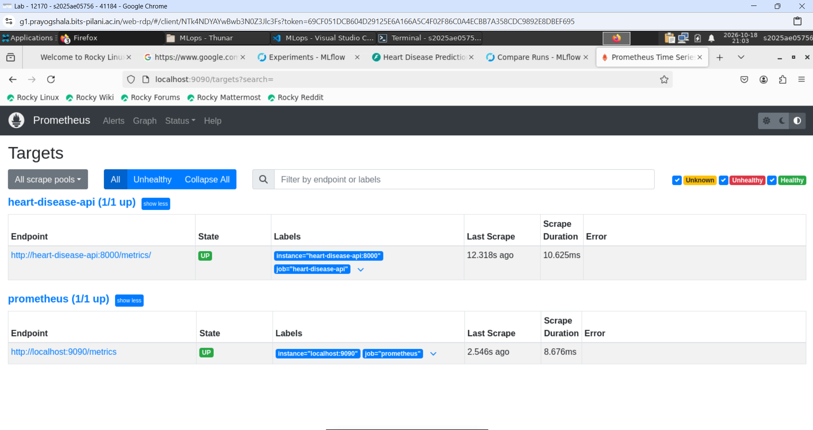
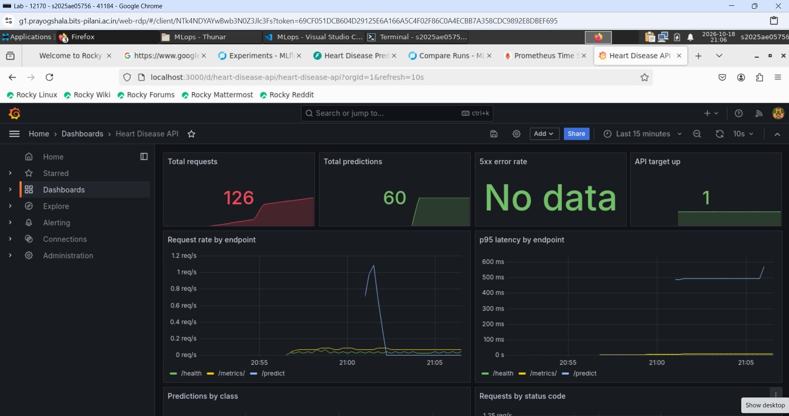

**Logging.** The service writes one JSON log line per request (method, path, status and duration) and one
per prediction. These are visible with `docker logs`, `docker compose logs api` or `kubectl logs`.

**Limitations.** The dataset is small (303 rows), comes from a single site (Cleveland) and is 68% male.
The held-out test set has only 61 rows, so test metrics are noisy, and the model has had no external or
clinical validation. The correlations found in the EDA are associations, not causal effects. The
`confidence` value is the model's probability for the predicted class and is not a calibrated clinical
risk. The model must not be used for diagnosis.

**Future work.** Data and model drift detection, alerting rules in Prometheus, a model registry with
staged promotion, probability calibration, and validation on larger multi-site data.

**Conclusion.** The project covers the full pipeline from acquisition to monitored deployment, and each stage
is automated, tested and documented. The modelling result is a near-tie between two model families, which is
why selecting on cross-validation, pinning versions and tracking every run in MLflow matter more here than
any single metric.

## Appendix: Architecture
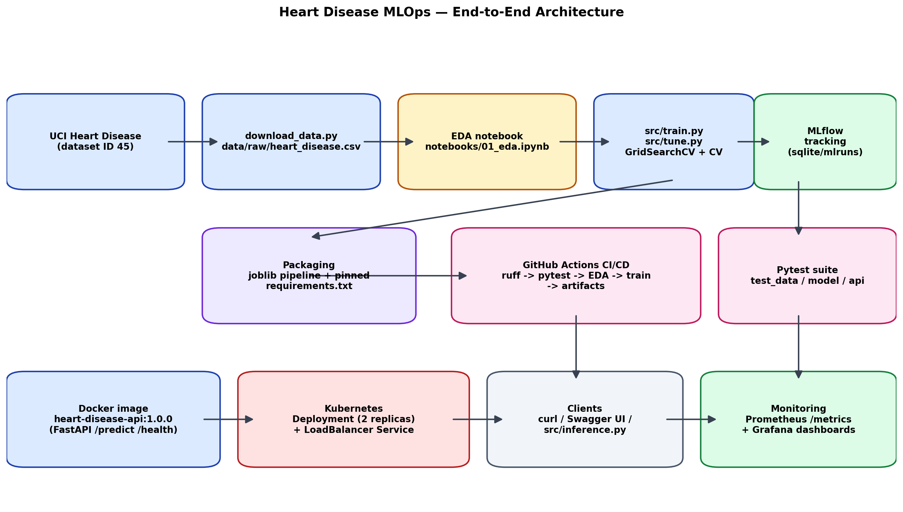